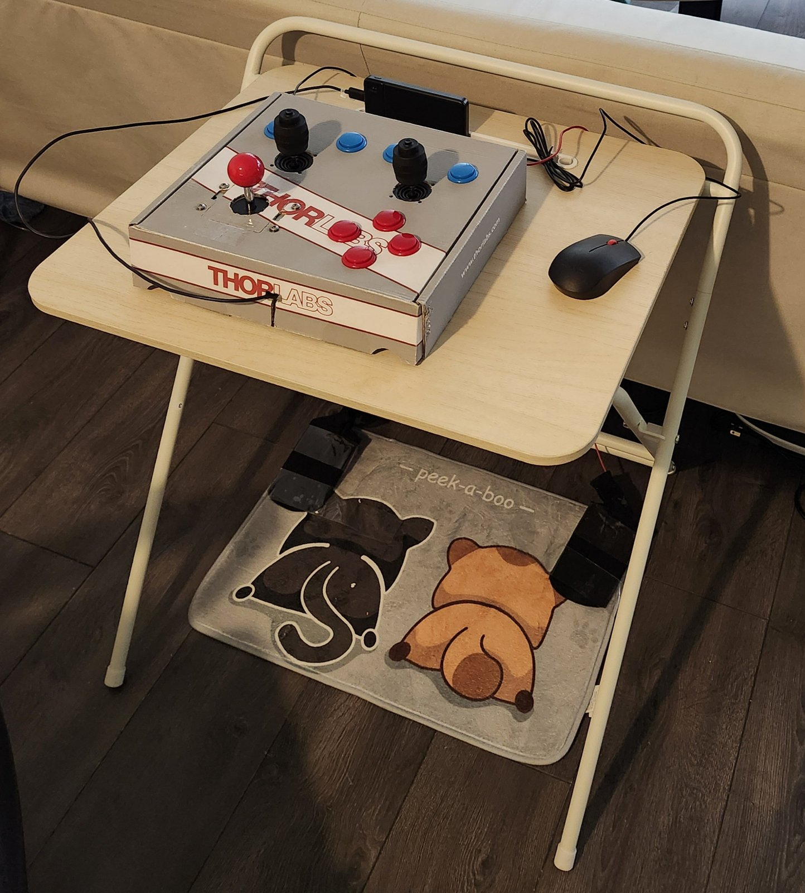

# ESP32 arcade controller for Switch and PC

An arcade-style game controller with full-size analog joysticks, arcade buttons,
and foot pedals, built to take the strain off thumbs and fingers. It connects
over Bluetooth as a Nintendo Switch Pro Controller or, on a PC, as an
Xbox-style (XInput) controller for Steam games.

- **Two 4-axis analog joysticks** for movement and camera, which most arcade
  sticks lack, plus a digital arcade stick for the D-pad.
- **Foot pedals** for ZL/ZR: two aluminum plates read by the ESP32's capacitive
  touch inputs, so held actions like shielding or drawing a bow move to the feet.
- **Mouse aiming.** A USB mouse, read through a CH9350 module, is sent to the
  Switch as native gyro motion while ZR is held, for precise bow aiming in
  *Tears of the Kingdom*. In PC mode it drives the right stick.
- **Two modes, one firmware.** Switch mode by default; hold B at power-on for
  XInput.

Read [`docs/project-story.md`](docs/project-story.md) for why it was built and
how the design evolved.

## Firmware

The firmware is a fork of
[HOJA-LIB-ESP32](https://github.com/HandHeldLegend/HOJA-LIB-ESP32). Besides
the two Bluetooth modes, it reads the physical buttons, two analog sticks,
capacitive ZL/ZR triggers, a TCA9555 button expander, and optional CH9350 mouse
input.

The hardware-verified firmware is in [`apps/controller`](apps/controller). The
refactored firmware at commit `1baf253` was built with ESP-IDF 5.0.1 and verified
on hardware in both Nintendo Switch Pro Controller and PC XInput modes.

## Repository map

- `apps/controller`: the controller firmware under active development.
- `examples/basic-wired-gamepad`: the original upstream example.
- `experiments`: retained prototypes and intermediate implementations.
- `docs`: project story, build, hardware, validation, project-history notes,
  and references.
- `cores`, `descriptors`, `include`, `resources`, `utilities`: the shared HOJA
  component and this fork's protocol fixes.

## Start here

1. Read [`docs/build-and-flash.md`](docs/build-and-flash.md).
2. Build from `apps/controller` with ESP-IDF 5.0.1.
3. Flash while manually putting the board into download mode.
4. Follow [`docs/validation.md`](docs/validation.md) to test Switch and XInput.

The `Gyro-mouse` branch is intentionally outside the current refactoring scope.
