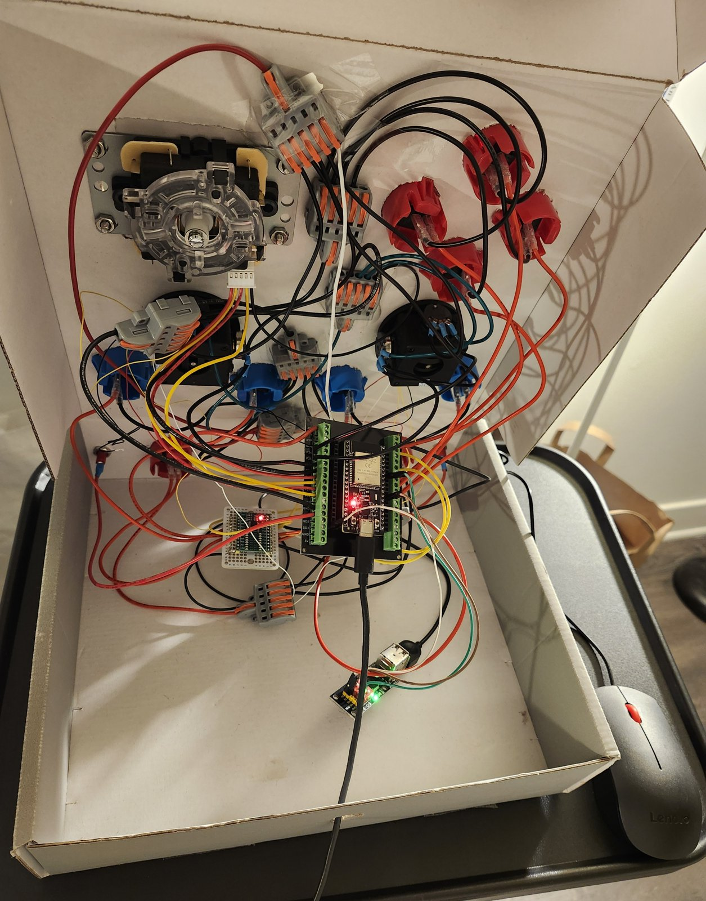
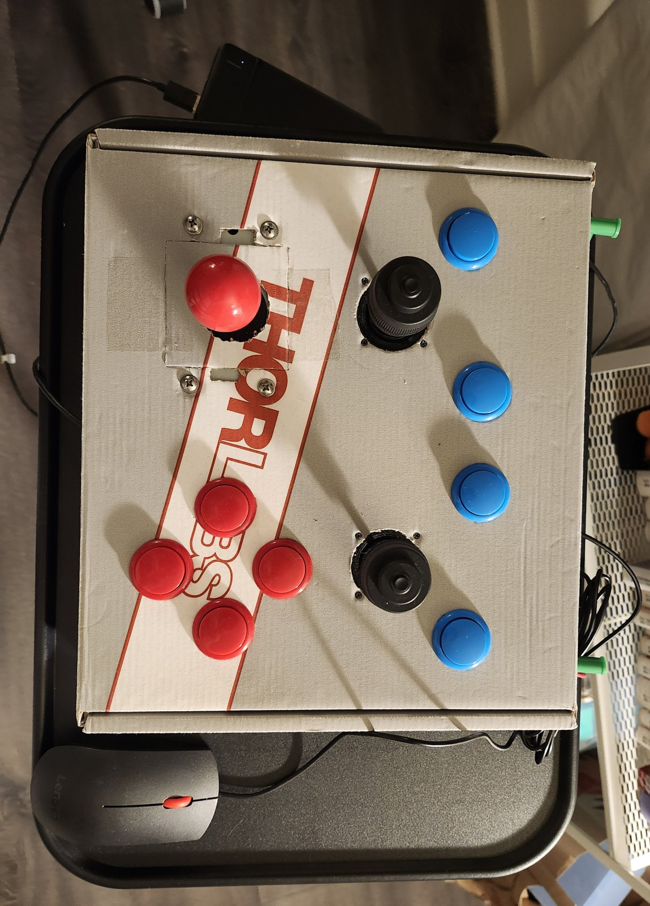
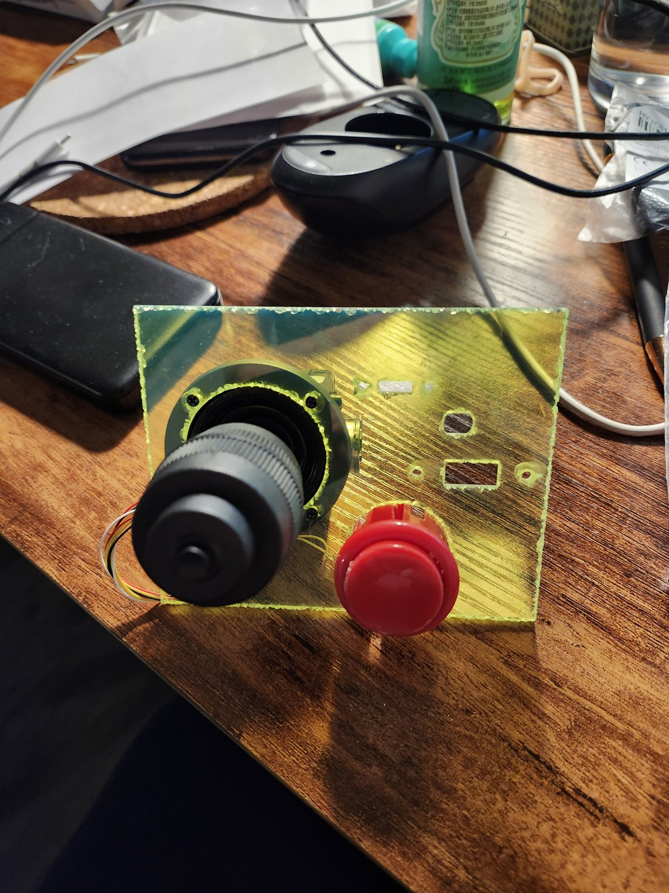

# Hardware map

This document describes the parts and pin assignments used by `apps/controller`.
Update it whenever the wiring or board revision changes.

## Components

| Part | Notes |
| --- | --- |
| ESP-WROOM-32, 38-pin dev board, with breakout board | HOJA-LIB-ESP32 supports this module; it did not run on an ESP32-S3 |
| 2 × JH-D400B-M4 10 kΩ analog joysticks | 4-axis industrial sticks: X, Y, twist, and a push button |
| Sanwa-style digital arcade stick | 8-way; a ground wire plus one wire per direction, two shorted for diagonals |
| Sanwa-style arcade buttons | Face, shoulder, and system buttons |
| TCA9555 I2C I/O expander | Extra digital inputs beyond the ESP32's free pins |
| 2 × foot-sized aluminum plates | Wired to ESP32 touch inputs as ZL/ZR foot pedals |
| CH9350L USB-host module | Reads a standard USB mouse and sends reports over UART |
| 2.8 mm spade-connector wires | Button wiring |
| USB power bank | Portable power |

Supplier links are collected in [`references.md`](references.md).

## Direct GPIO buttons

| Input | ESP32 GPIO |
| --- | ---: |
| A | 19 |
| B | 18 |
| X | 17 |
| Y | 23 |
| D-pad up | 25 |
| D-pad left | 27 |
| D-pad down | 26 |
| D-pad right | 14 |

These inputs are active low and use the ESP32 internal pull-ups.

## Analog sticks

| Axis | ESP32 GPIO / ADC1 channel |
| --- | --- |
| Left X | GPIO32 / channel 4 |
| Left Y | GPIO33 / channel 5 |
| Right X | GPIO34 / channel 6 |
| Right Y | GPIO35 / channel 7 |

Calibration values are currently board-specific and live in `analog_sticks.c`.

### Stick calibration

The 12-bit ADC reads 0 to 4095 at the extremes, but each stick springs back to a
slightly different rest value depending on which side it returns from. Measured
rest values (September 2025):

| Axis | Rest after max | Rest after min | Center used | Minimum dead zone |
| --- | ---: | ---: | ---: | ---: |
| Left X | ~1890 | ~1780 | 1835 | 55 |
| Left Y | ~1790 | ~1680 | 1735 | 55 |
| Right X | ~1900 | ~1770 | 1835 | 65 |
| Right Y | ~1920 | ~1770 | 1845 | 75 |

The firmware uses these centers with a 100-count dead zone on every axis. The
left stick's twist axis rests near 1800 and needs a dead zone of about 200. The
twist axes were planned for GPIO36 (left) and GPIO39 (right) but are not read
by the current firmware.

## Other input devices

| Device | Connection | Purpose |
| --- | --- | --- |
| TCA9555 at `0x20` | I2C0: SDA 21, SCL 22, 100 kHz | L/R, stick clicks, Select, Start, Capture, Home |
| ESP32 touch pads | Touch 0 / GPIO4 (ZR), Touch 4 / GPIO13 (ZL) | Capacitive digital triggers (foot pedals) |
| CH9350L | UART2 RX on GPIO16, 115200 baud | Optional mouse input |

The touch inputs calibrate a baseline at startup and report a press when the
reading drops below 78% of it (`BOARD_TOUCH_THRESHOLD_RATIO`), so keep feet off
the pedals while the controller powers on.

On the CH9350 module used here, set DIP switch 5 up and switches 1–4 down.

The CH9350L's two USB host connections are labeled port 1 (`DP/DM`) and port 2
(`HP/HM`) in the chip documentation. Either can accept a mouse when both are
wired on the module; the physical upper/lower position depends on the board.

The abandoned CST816 touchscreen prototype is retained under
`experiments/touchscreen-Nintendo-switch`; it is separate from the capacitive
ZL/ZR inputs used by the active firmware.

### CH9350 aim mapping

In Switch mode, holding the ZR touch pedal or the mouse right button selects
the CH9350 aim path when mouse input has not been disabled at startup. Either
input also reports ZR pressed, so the right mouse button can draw and release
a bow in Zelda games.
The mouse left button has no mapping. In Switch mode, horizontal mouse motion
is mapped with inverted sign to synthetic gyro Z (yaw), and vertical mouse
motion to gyro X (pitch). Both signs were flipped after the first hardware
test reported reversed aim on both axes. The
Switch's `0x40` IMU-enable command must be active before those samples are sent.
The CH9350 does not provide acceleration, so all accelerometer axes are zero.
Mouse deltas are drained at the roughly 10 ms Switch report cadence, scaled
and clamped to the signed 16-bit report range, and reset to zero whenever ZR
is not held. `BOARD_MOUSE_GYRO_YAW_RAW_PER_DELTA` controls horizontal aim
(mouse X, currently 40); `BOARD_MOUSE_GYRO_PITCH_RAW_PER_DELTA` controls
vertical aim (mouse Y, currently 150). Smaller values slow the corresponding
axis; each change requires a rebuild and flash. Earlier test values were 55/150,
72/96, 80 for both axes and, initially, 160.

In XInput mode, the original ZR touch pedal still enables mouse-to-right-stick
aim and sets the right trigger. The mouse buttons are not mapped in that mode.
Holding A during startup disables all CH9350 input in either mode.

## Programming controls

The board requires manual BOOT/download and EN/RESET button operation for flashing.
See `build-and-flash.md` for the sequence.

## Enclosure

The working prototype is a repurposed Thorlabs shipping box, about 2.5 inches
deep, with holes cut for each stick and button.

Two sturdier designs have been explored:

- **Finger-jointed box.** [MakerCase](https://www.makercase.com/basicBox)
  generates DXF files for a box that can be laser cut and assembled with
  finger joints.
- **Corner-bracket box.** Flat panels, such as 0.118 in polycarbonate sheet,
  joined with corner brackets. A waterjet-cut acrylic test plate (January 2026)
  checked the mounting cutouts for an analog stick and a button:

On the prototype panel, the left analog stick sits too close to the digital
stick; the next layout should separate them.
