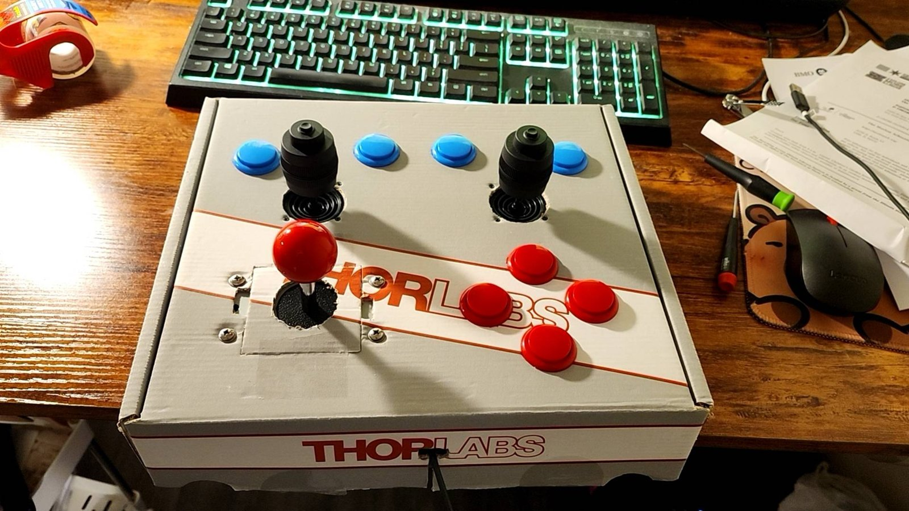
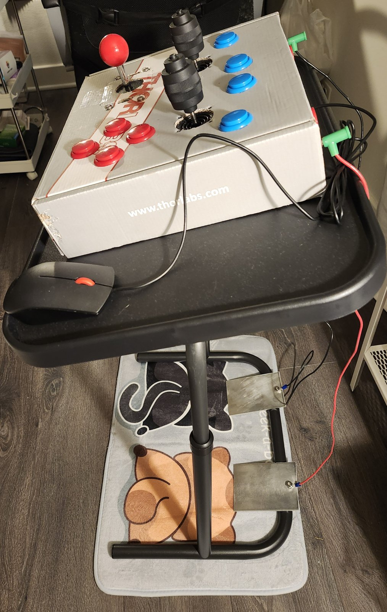
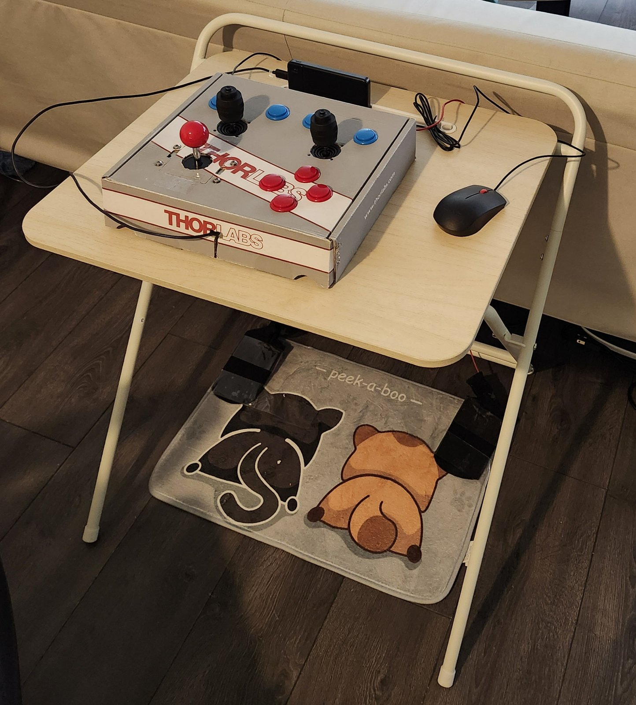

# Project story

This is the background and design reasoning behind the controller. The first
part was written in September 2025, when the cardboard prototype was working on
Switch; [Since then](#since-then) describes what changed afterwards.

## What it is

An arcade-style Nintendo Switch controller. The core is an ESP-WROOM-32 module
running [HOJA-LIB-ESP32](https://github.com/HandHeldLegend/HOJA-LIB-ESP32), a
library that already handles the whole path from reading buttons and analog
sticks to reporting them to the console over Bluetooth.

The prototype uses:

- two industrial 4-axis analog joysticks (JH-D400B-M4, 10 kΩ; listings use
  slightly different part numbers for essentially the same stick),
- one Sanwa-style digital arcade stick for the D-pad,
- Sanwa-style arcade buttons in two colors,
- two foot-sized aluminum plates wired to the ESP32's capacitive touch inputs,
  used as foot pedals.

The enclosure is a repurposed Thorlabs shipping box with holes cut for each
part. With it, the
prototype reproduced every button and stick of a Switch Pro Controller. Gyro and
rumble were left out: on a box this large they add little.

## Why build it

The idea came from playing *Heave Ho* with an Xbox controller. The game is fun,
but you hold a trigger to grip while rotating your character with the thumb
stick, and after half an hour to an hour my hands hurt. Long sessions of *The
Legend of Zelda: Tears of the Kingdom* did the same: long gamepad sessions leave
my fingers sore and aching. A standard gamepad puts nearly all the load on the
thumbs and index fingers. A keyboard and mouse at least spreads it across more fingers.

An arcade layout moves the work to larger joints. You grip a stick with the
whole hand. The buttons are big and sturdy enough to press with several fingers,
or even a fist, and they are cheap to replace. Moving between controls uses the
shoulder, elbow, and arm instead of the thumb pivoting at its base knuckle;
those joints have more muscle around them and wear less easily.

I worried that a larger layout would be slower. After a few days of *Tears of
the Kingdom* on the prototype, it was not a problem: my fingers did not tire and
the controls felt natural. Shoulders and arms may react a little slower than
fingers, but that is fast enough for most games.

## Foot pedals

On a Pro Controller, the thumbs handle the sticks and face buttons while the
index and middle fingers cover L, R, ZL, and ZR. On this controller, L and R
moved to the panel (in *Tears of the Kingdom* you rarely hold them while
pressing something else), and the two foot plates act as ZL and ZR. Those are
the buttons games ask you to hold for a long time: raising a shield, drawing a
bow.

This turned out to help more than expected. A perfect dodge in *Tears of the
Kingdom* means holding ZL, then tilting the left stick and pressing X at the
right moment; a perfect parry means holding ZL and pressing A at the right
moment. With the pedals, I rest my left foot on the plate at the start and stop
thinking about it, then focus on the stick and the A or X button. My success
rate for perfect dodges and parries is higher than with a gamepad, because I no
longer split attention on keeping a trigger held.

## Setup

I sit at a table low enough that my knees and ankles are at about 90°. The table
is slightly above knee height, lower than a desk: the sticks are tall and the box
is about 2.5 inches thick, so a lower panel keeps the arms relaxed. The two foot
plates sit on the floor on wedges, angled like car pedals. With a monitor, it is
effectively a home arcade cabinet.

## How it differs from existing arcade sticks

Many people build or sell arcade sticks and full cabinets, but almost none have
analog sticks. They target classic arcade games, which predate analog input, so
they use 8-way digital sticks like the Sanwa. This controller covers every
important Pro Controller function, analog sticks included.

Why not use an ESP32 with a USB host board and a keyboard and mouse? I tried a
keyboard-and-mouse adapter for *Tears of the Kingdom* and gave up after ten
minutes. Mapping keyboard keys to Switch buttons kept breaking the gamepad habits
I already had. An arcade panel keeps the modern gamepad's layout and logic, just
enlarged.

## Early design decisions

- **Analog, not just digital.** The first firmware I tried, Mundo Yakara's
  [ESP32 arcade tool](https://yakaracolombia.github.io/esp32-online-tool/arcade2.html),
  connected and worked, but its stick drives the D-pad. Character movement in
  *Animal Crossing* and *Zelda* uses the left analog stick, and the camera uses
  the right one. Most Switch arcade-stick projects target retro games and skip
  analog entirely. The Sanwa stick I bought (JLF-TP-8YT) turned out to be
  digital too: one ground wire plus one wire per direction. So the plan became
  real analog joysticks read through HOJA's analog-stick support.
- **ESP32, not ESP32-S3.** The only reason to want the S3 was its pin count.
  HOJA-LIB-ESP32 targets the original ESP32, and the library did not work after
  flashing it to an S3; porting would have meant changing imports and the
  Bluetooth stack. The pin budget for full Pro Controller coverage was 16
  digital inputs and 4 ADC channels, plus nice-to-haves: the sticks' twist axes,
  Capture and Home, and a reconnect button. That does not fit the WROOM-32's
  free pins, so a TCA9555 I2C expander now carries L/R, the stick clicks,
  Minus/Plus, Capture, and Home.

## Since then

The September 2025 version had no gyro, so aiming a bow in *Tears of the
Kingdom* relied on the right stick. It could hit enemies but rarely headshots,
where the Pro Controller's gyro makes small corrections easy. The plan was to
add a CH9350 USB-host board and connect a mouse.

That is now done, and the firmware has grown:

- **Mouse aiming.** A USB mouse connects through a CH9350L module. In Switch
  mode, mouse motion is sent as native gyro data while ZR is held (from the foot
  pedal or the mouse's right button), so in-game gyro aiming works as it does
  with a Pro Controller. In September 2026 the mouse was working in *Tears of the
  Kingdom*, with separate horizontal and vertical sensitivity.
- **PC mode.** HOJA also includes a Bluetooth XInput (Xbox-style) core. Holding B
  at power-on starts the controller in that mode, so it pairs with a PC and works
  in Steam games. It passed Steam's controller test and was used to play *Split
  Fiction*.
- **Firmware cleanup.** The firmware was reorganized into one maintained app with
  separate modules for sticks, buttons, touch pedals, and mouse input; see
  [`project-history.md`](project-history.md).
- **Enclosure.** A waterjet-cut acrylic test plate (January 2026) checked hole
  sizes for a sturdier box; see [`hardware.md`](hardware.md#enclosure).

## Known issues and ideas

- The left analog stick and the digital stick are placed too close together on
  the prototype panel.
- Each analog stick has a third, twist axis. It is not used yet; one idea was to
  threshold it into extra digital buttons.

## Who it might help

Players whose fingers get sore from gamepads but who still want gamepad games,
arcade-stick fans, and anyone curious to try a different way to play.
